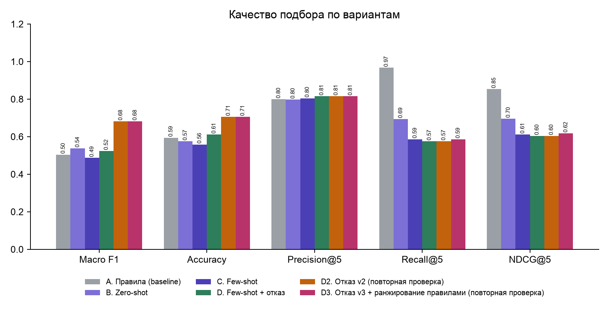
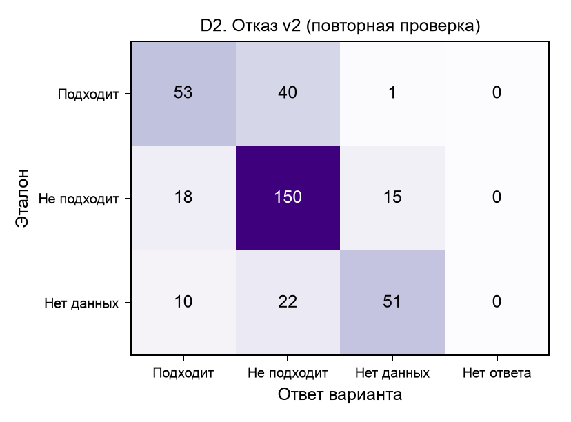

**ЛЗ 12 — ИИ-подбор питомца:** [Обзор](ЛЗ-12-Обзор) · [Карточка функции](ЛЗ-12-Карточка-функции) · [Eval-набор](ЛЗ-12-Eval-набор) · [Замер и ошибки](ЛЗ-12-Замер-и-ошибки) · [Стоимость](ЛЗ-12-Стоимость) · [Риски](ЛЗ-12-Риски) · [ADR-002](ЛЗ-12-ADR-002) · [Самопроверка](ЛЗ-12-Самопроверка)

---

# Замер качества и разбор ошибок

Провайдер Groq, модель `openai/gpt-oss-20b`, temperature 0, seed 42 (best effort), промпт `reco-v1`.
Сырые ответы: `evals/raw/2026-11-24_231857_openai_gpt-oss-20b/`. Выполнено 31 из 36 сценариев, 5 — суточный лимит API (засчитаны как «нет ответа»).

| Вариант | Accuracy | Macro F1 | P@5 | R@5 | NDCG@5 | Нарушения | Верный отказ |
|---|---|---|---|---|---|---|---|
| A. Правила | 0,594 | **0,504** | 0,799 | 0,967 | 0,853 | 39/152 | 2/18 |
| B. Zero-shot | 0,575 | **0,538** | 0,797 | 0,694 | 0,696 | 19/95 | 6/18 |
| C. Few-shot | 0,558 | **0,487** | 0,804 | 0,586 | 0,611 | 20/90 | 4/18 |
| D. Few-shot + отказ v1 | 0,611 | **0,524** | 0,815 | 0,575 | 0,604 | 17/72 | 8/18 |
| D2. Отказ v2 (повторная проверка) | 0,706 | **0,682** | 0,815 | 0,575 | 0,604 | 17/72 | 8/18 |

| F1 по классам | A. Правила | B. Zero-shot | C. Few-shot | D. Few-shot + отказ v1 | D2. Отказ v2 (повторная проверка) |
|---|---|---|---|---|---|
| Подходит | 0,566 | 0,570 | 0,541 | 0,546 | 0,606 |
| Не подходит | 0,755 | 0,704 | 0,690 | 0,732 | 0,759 |
| Недостаточно данных | 0,191 | 0,339 | 0,229 | 0,293 | 0,680 |

## Разбор ошибок

Разобраны все сценарии, где итоговый вариант (D2) ошибся хотя бы в одной паре или выдал запрещённую рекомендацию: 27 из 36. «Верных пар» — из 10 кандидатов сценария, порядок A / C / D / D2. Повторная проверка выполнена на том же наборе (без новых запросов к модели), поэтому это проверка на наборе разработки, а не независимая оценка.

| ID | Запрос | Тип | Причина | Исправление | Повторная проверка |
|---|---|---|---|---|---|
| sc-11 | собака во двор | Постановка / разметка | Эталон ставит «нет данных» при неполной анкете человека, промпт v1 — только при unknown в карточке животного | Правило отказа v2: при ≥ 2 пустых обязательных полях все пары, не исключённые правилами, — «Недостаточно данных» | D2: 10/10 (было 1/10) |
| sc-18, sc-23, sc-30 | «для ребёнка», «хочу кого-нибудь милого», «спорт» | Постановка / разметка | Та же причина: очень короткий или неоднозначный запрос без анкеты | Правило отказа v2 | D2: 10/10 в каждом (было 1, 4 и 0) |
| sc-04 | Дома уже есть кот, ищем ему компанию | Ошибка модели | Модель считает отличие активности на один уровень жёстким ограничением | Промпт v3: несовпадение активности на один уровень — повод для ранжирования, а не для «Не подходит» | Не проводилась: суточный лимит Groq исчерпан |
| sc-08, sc-12, sc-01, sc-17 | дом + взрослая собака; запрос на казахском; спокойная кошка | Ошибка модели | Та же строгость по активности + неверное чтение поля apartment_ok=no как «не подходит для дома» | Промпт v3: пояснить, что apartment_ok относится только к квартире | Не проводилась: лимит API |
| sc-22 | Студентка, учусь онлайн, впервые беру кошку | Ошибка модели | Применяет ограничение, не относящееся к человеку | Промпт v3 + проверка: причина «Не подходит» должна ссылаться на поле анкеты | Не проводилась: лимит API |
| sc-31 | Работаю по 10 часов, хочу самостоятельную кошку | Ошибка модели (неполный ответ) | Режим json_object не гарантирует, что модель перечислит всех кандидатов | response_format json_schema (Structured Outputs) с обязательным списком всех id | D (v1): пропуски стали «нет данных» — 6/10 (было 0/10) |
| sc-28 | Активный отдых по выходным, в будни работаю по 12 часов | Пробел в правилах (данные) | Нет правила «собака + меньше часа в день»: R9 срабатывает только при сложном уходе | Новое жёсткое правило: собака при time_per_day = low → «Не подходит» (до следующего замера) | Не проводилась: правило добавляется в следующей версии |
| sc-21, sc-34 | «Опыта нет, но хочу хаски или овчарку»; «Хочу персидскую кошку, но на уход времени почти нет» | Дефект бизнес-процесса | Не определено, можно ли предлагать другую породу вместо запрошенной. Функция по заданию должна предлагать безопасные альтернативы, эталон это запрещает | Решение команды: альтернативы показывать отдельным блоком «можно обсудить с сотрудником», а не в рекомендациях | Требует решения команды |
| sc-14 | Дочке 10 лет, мечтает о котёнке | Спорная разметка | По карточкам кошки ладят с детьми и подходят новичку, но эталон запрещает все варианты. Причина в разметке не указана | Вынести на повторное согласование; до решения не считать ошибкой модели | Требует согласования |
| sc-16 | Малышу год, хотим питомца, но времени мало | Противоречие в разметке | Эталон одновременно разрешает пару и запрещает рекомендации | Исправить эталон при следующей разметке | Требует согласования |
| sc-35 | Есть кошка, днём никого нет дома, нужна вторая для компании | Спорная разметка | По карточкам эти кошки ладят с другими кошками и подходят для квартиры, но эталон запрещает все варианты. Причина в разметке не указана (как в sc-14) | Вынести на повторное согласование; до решения не считать ошибкой модели | Требует согласования |
| sc-05, sc-09 | аллергия у мужа; кошка будет гулять по участку | Недостаток данных | В карточке нет полей «гипоаллергенность» и «безопасный выгул» | Добавить поля в карточку животного; до этого — уточняющий вопрос | Не проводилась: нужны новые данные |
| sc-25, sc-26 | бегаю 10 км; ходим в горы | Недостаток данных | Активность high ≠ подтверждённая выносливость для длительных нагрузок | Поле «выносливость / подходит для спорта» в карточке | Не проводилась: нужны новые данные |
| sc-32 | Мало времени, но могу гулять 30 минут два раза в день | Ошибка модели | Модель читает поле time_per_day=low как запрет, хотя в тексте прямо названо 1 час прогулок в день | Промпт v3: конкретные цифры из текста важнее поля анкеты; среднюю активность при ежедневных прогулках не исключать | Не проводилась: нужен прогон промпта v3 |
| sc-33 | Часто в командировках, кого посоветуете? | Недостаток данных в анкете | В анкете нет вопроса «кто ухаживает, когда вас нет несколько дней»: поле «мало времени» не передаёт отсутствие по нескольку суток, анкета формально полная, поэтому правило отказа не срабатывает | Добавить в анкету вопрос об отъездах; при упоминании командировок или отъездов — уточняющий вопрос | Не проводилась: нужен новый вопрос анкеты |

## Правило отказа
Правило отказа сравнивалось в трёх состояниях на одних и тех же ответах модели (36 сценариев). C (без правила): macro F1 0,487, F1 «Недостаточно данных» 0,229, нарушений 20 из 90 выданных рекомендаций (22,2 %). D (v1: проверка жёстких ограничений по карточке, пропуск = «нет данных», уточнение при ≥ 2 пустых полях анкеты): macro F1 0,524, нарушений 17 из 72, верных отказов 8 из 18 (у C — 4). D2 (v2: плюс «нет данных» для всех кандидатов при неполной анкете): macro F1 0,682, F1 «Недостаточно данных» 0,680, accuracy 0,706 (у C — 0,558). Выданных рекомендаций становится меньше (90 → 72), но доля нарушений почти не меняется (22,2 % → 23,6 %): правило снимает в основном верные рекомендации, а запрещённые остаются в сценариях, где анкета полная (sc-14, sc-34, sc-35). Вариант D3 (v3: плюс ранжирование подходящих по баллам правил R15–R18) даёт те же метки и почти тот же NDCG@5 (0,617 против 0,604). Правило отказа не использует «уверенность», которую называет модель: только полноту анкеты и подтверждённые поля карточки.

## Итог
На всех 36 сценариях итоговый вариант D2 даёт macro F1 0,682 против 0,504 у baseline и лучше baseline по F1 каждого класса: «Подходит» 0,606 против 0,566, «Не подходит» 0,759 против 0,755, «Недостаточно данных» 0,680 против 0,191. Но правило отказа v2 придумано после просмотра ошибок на этом же наборе, поэтому это повторная проверка на наборе разработки. По ранжированию ИИ уступает правилам: NDCG@5 0,604 против 0,853, Recall@5 0,575 против 0,967; в категории «ограниченное время» D2 не выдал ни одной верной рекомендации. Доля нарушений 23,6 % (17 из 72) при пороге 2 % (у baseline — 25,7 %). Критерий приёмки не выполнен: функцию нельзя включать для реальных пользователей без промпта v3 и независимого замера на реальных обращениях с ручной разметкой.
