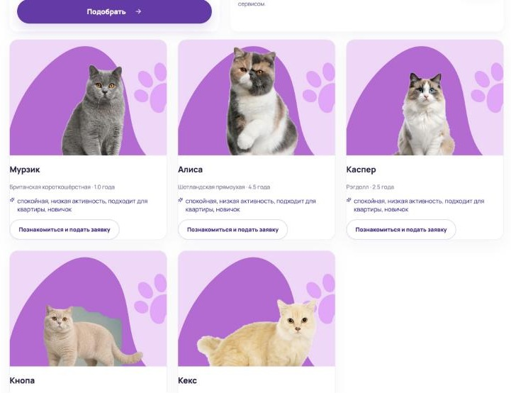

**ЛЗ 12 — ИИ-подбор питомца:** [Обзор](ЛЗ-12-Обзор) · [Карточка функции](ЛЗ-12-Карточка-функции) · [Eval-набор](ЛЗ-12-Eval-набор) · [Замер и ошибки](ЛЗ-12-Замер-и-ошибки) · [Стоимость](ЛЗ-12-Стоимость) · [Риски](ЛЗ-12-Риски) · [ADR-002](ЛЗ-12-ADR-002) · [Самопроверка](ЛЗ-12-Самопроверка)

---

# ЛЗ 12. План ИИ-функции: evals, стоимость, риски

Функция: **интеллектуальный подбор питомца** на PetHome — анкета, ИИ-чат и персональные рекомендации (одна функция).
Модель: `openai/gpt-oss-20b` через Groq. Замер 2026-11-24, коммит `a0af9d9`.

| Итог | Значение |
|---|---|
| Baseline (18 правил) | macro F1 0,504, NDCG@5 0,853 |
| Итоговый гибрид D2 | macro F1 0,682, NDCG@5 0,604, нарушений 17/72 |
| Стоимость | $0.000337 за запрос, ≈ 207 ₸/мес, ×10 — ≈ 2070 ₸/мес |
| Решение (ADR-002) | **Отложено**: критерий приёмки не выполнен |

Отчёт Word: `docs/lab12/ЛЗ_12_PetHome_План_ИИ_функции.docx`. Код: `backend/recommender.py`, `src/matcher.jsx`, `evals/`.

