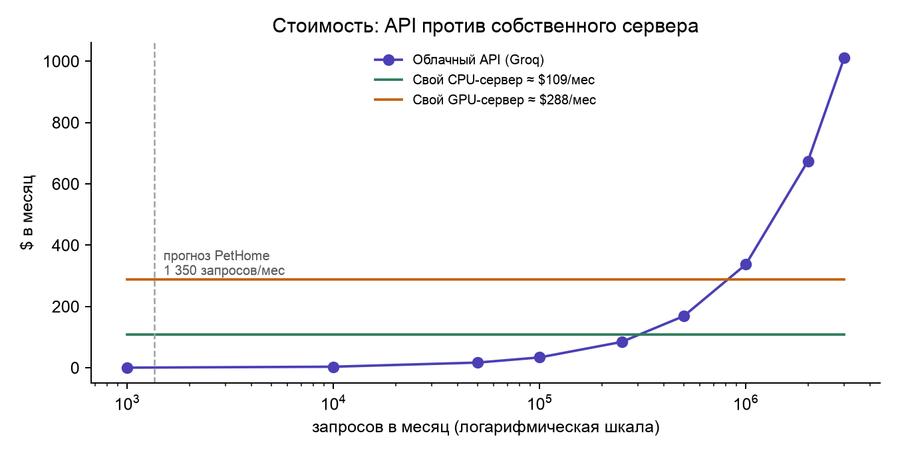

**ЛЗ 12 — ИИ-подбор питомца:** [Обзор](ЛЗ-12-Обзор) · [Карточка функции](ЛЗ-12-Карточка-функции) · [Eval-набор](ЛЗ-12-Eval-набор) · [Замер и ошибки](ЛЗ-12-Замер-и-ошибки) · [Стоимость](ЛЗ-12-Стоимость) · [Риски](ЛЗ-12-Риски) · [ADR-002](ЛЗ-12-ADR-002) · [Самопроверка](ЛЗ-12-Самопроверка)

---

# Стоимость эксплуатации

Токены — счётчик провайдера: 3021 входных и 368 выходных на запрос. Тариф Groq gpt-oss-20b: $0,075 / $0,30 за 1 млн
(console.groq.com/docs/models, 24.11.2026). Курс 455.12 ₸/$ (НБРК, 24.11.2026). Формулы: `evals/results/cost-model.xlsx`.

| Показатель | Прогноз | Рост ×10 |
|---|---|---|
| Запросов в месяц | 1,350 | 13,500 |
| В месяц | $0.45 ≈ 207 ₸ | $4.55 ≈ 2070 ₸ |
| В год | $5.46 ≈ 2484 ₸ | $54.59 ≈ 24845 ₸ |
| Бесплатный тариф Groq | да | нет |

Свой CPU-сервер ≈ $109/мес — точка безубыточности 323,491 запросов/мес (×240); GPU ≈ $288/мес —
855,375 (×634). Для PetHome недостижимо: спор «свой сервер или API» — про данные, а не про деньги.

